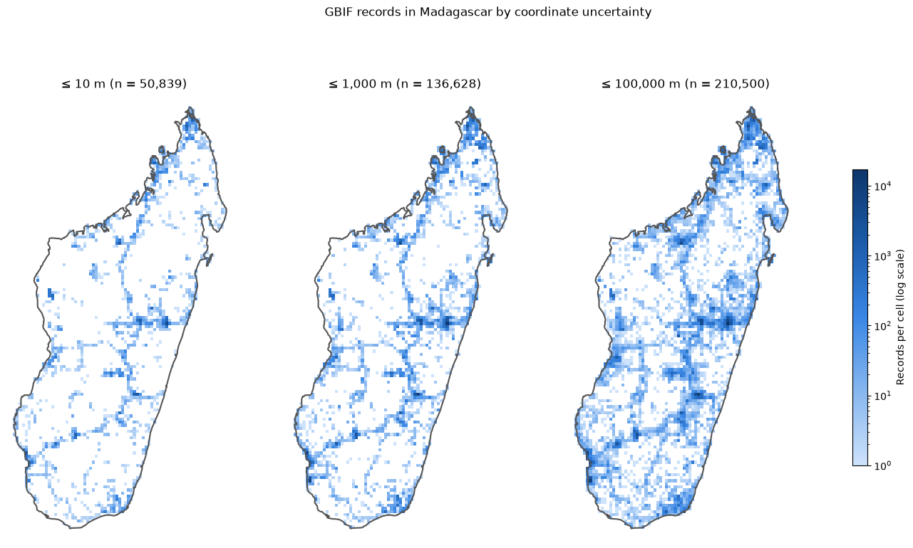
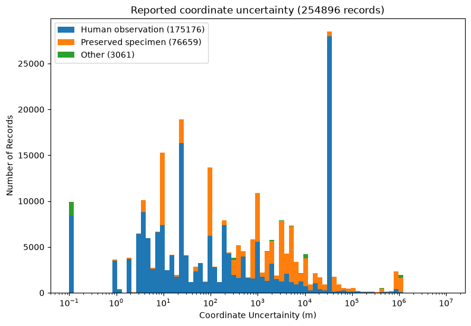
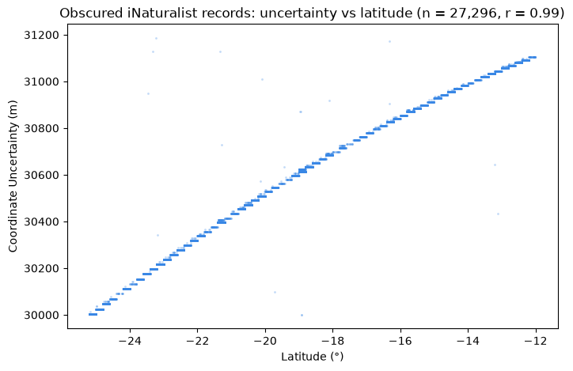

# Dissertation Outline

This week was my first proper week working on my dissertation "Evaluating different techniques for creating habitat maps from noisy GBIF data and Tessera embeddings". The goal of my project is to use data from the [Global Biodiversity Information Facility](https://www.gbif.org/what-is-gbif), which is a massive open database combining species occurrence records across thousands of sources, as labels to train a classifier over different habitat types such as wetland, savanna, forest and others. If all the data from the GBIF were clean, this would be a fairly standard classification problem. The reason for my project's existence is that the problem is made more challenging by the fact that the GBIF's billions of records vary wildly in location accuracy and uncertainty. Therefore, a common approach is simply ignoring large portions of the data which have intolerable amounts of uncertainty. This is where the majority of my project's work will be done, as I plan on using uncertainty conscious methods to include a greater number of records and hopefully create more accurate habitat maps. The actual inputs I will use to train the classifier will be the [Tessera](https://geotessera.org/) embeddings, which form a 10m resolution grid of the planet's entire land surface where each square encodes a year's worth of satellite data.

I have to give a big thanks to [Dr Aneesh Naik](https://www.aneeshnaik.com/about.html) who proposed this project and who has already been a huge help with laying out a roadmap of areas for me to explore. I also am lucky enough to have [Dr Michael Winston Dales](https://digitalflapjack.com/) as my day-to-day supervisor and [Professor Anil Madhavapeddy](https://anil.recoil.org/) as my marking supervisor, both of whom have already been so generous with giving up their time to provide ample resources and feedback.

# First steps
With the project proposal finished, I can finally start diving into the project. A natural starting point is to actually have a look at the data I have to investigate. For the sake of getting off the ground I chose Madagascar as an area to investigate as it has roughly 3.8 million records which is far more manageable compared to the UK with more than 266 million records. The first thing I noticed when viewing the data, was how few records actually contained both a location and an uncertainty, with only 6.6% having both. The next thing I did, inspired by Michael's plots, was to create a few maps showing off the density of records across the country to give a rough indication of the sampling bias as well as the different bands in uncertainty I was seeing.

As you can see there is a significant group of records with uncertainty above 1000m, which reinforces the need for classification methods which can make sense of this. You can also clearly see from the maps how records are naturally clustered around where the cities and national parks are and fall off massively in more rural areas. This is by no means a groundbreaking observation but it is something I will need to consider when generating synthetic data later. To get a better look at the uncertainty spread, the next thing I did was to plot a bar chart of uncertainty bins.

The two spikes at both ends are what stand out the most here. Looking into the leftmost spike showed 9907 records with sub-metre precision. This is clearly a red flag as these turned out to all come from marine surveys so I've deemed it appropriate to ignore these as this is false precision. The second spike (the one on the right with the uncertainty range from 30000-31200m) is more interesting and required a bit more digging. I realised that the uncertainty follows latitude almost perfectly which implied there was some kind of systematic location based mechanism going on here.

It turns out this uncertainty comes from iNaturalist's automatic [geoprivacy algorithm](https://help.inaturalist.org/en/support/solutions/articles/151000169938). How it works is they randomise the position in a 0.2° x 0.2° cell to obscure the true location of the occurrence. Looking at the data, the uncertainty lines up almost exactly with the diagonal length of each cell. Therefore the curvature of the Earth explains why uncertainty is correlated with latitude! The geoprivacy feature is designed to obscure the location of endangered species but throws a bit of a wrench in my classification. However I still think this data can be used but once again I will have to consider it in the distribution I make for the synthetic data.

# Why Weeknotes?
I feel like I should describe why I felt the need to start writing weeknotes but their purpose has already been explained well by my director of studies [Professor Jon Sterling](https://www.jonmsterling.com/) in his post ["Write first, then meet"](https://www.jonmsterling.com/01JS/). For me especially, I've realised that throughout the course of the CS Tripos, my prose writing muscles have slowly atrophied from lack of use. I feel like the ability to write is a useful skill which I don't want to fully lose as I get older so I'm going to try and stay as consistent as I can! Also I plan on setting this up with an Atom feed in the future so stay tuned for that!